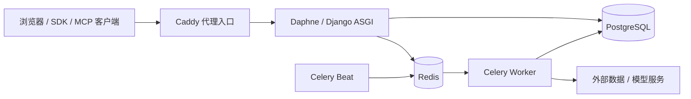
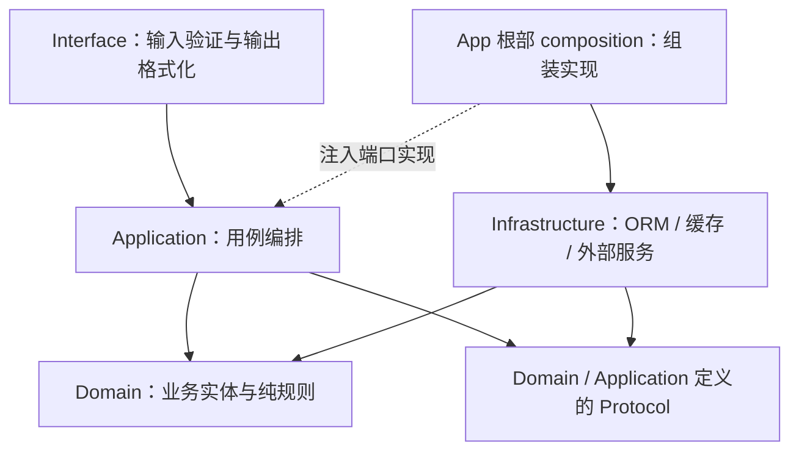

# AgomTradePro 项目结构说明

> 维护日期：2026-10-26。本文提供可独立阅读的系统概览、技术栈、模块职责、架构图和关键数据流。
> 模块内部文件、模型字段、路由和数量由生成物维护；本文区分当前代码布局、架构规范与尚未完成的重构目标。
> 版本与发布说明：[VERSION.md](../VERSION.md)；执行状态：[计划注册表](../../governance/active_plan_registry.json)。

## 1. 系统做什么

AgomTradePro 是个人投研系统，围绕“理解市场环境、研究资产、制定账户计划、核对结果”组织能力。Regime 描述增长/通胀等市场环境，Policy 提供政策与约束背景；资产、信号、策略和风险模块将这些信息用于研究与计划。过滤是否带来投资增量价值，需要真实数据和样本外验证，不能由架构本身保证。

当前交付主线是 A 股研究、模拟调仓与手工辅助下单，主要用户任务是：

- 研究一个标的：确认证券身份，查看行情、估值、财务和相关研究，同时知道缺失数据与结论限制。
- 检查一个账户：结合持仓、现金、可卖数量、目标和风险约束，获得可解释的调仓计划。
- 核对执行结果：模拟交易按结算规则记账；外部实际成交通过明确的导入/记录操作留存，再做对账与复盘。

浏览器中的 `/tui/` 是主要任务界面；SDK 和 MCP 提供程序化访问，Classic Web 保留迁移期兼容入口。真实券商自动下单属于独立能力，保持默认关闭，需用户主动开启且具备实际账户、来源、风控和执行资格。

模块存在、开发测试通过、真实数据可用、普通用户验收和发布资格分别取证。具体已交付范围读取 [A 股主计划](../plans/a-share-usability-implementation-plan-2026-10-16.md)、[Owner 决策记录](../reviews/owner-scope-freeze-2026-10-18/approval-log.md)及当前候选证据；本文不维护进度百分比或整个系统“生产就绪”的断言。

## 2. 技术栈与运行组件

| 层面 | 主要技术 | 在系统中的作用 |
| --- | --- | --- |
| 后端语言与 Web | Python、Django、Django REST Framework | 业务用例、认证、HTTP 接口与后台管理 |
| 实时连接 | ASGI、Daphne、Django Channels | HTTP 服务与经过认证的实时 WebSocket 连接 |
| 数据库 | PostgreSQL；本地可用 SQLite | 业务事实、配置与历史记录；正式环境采用 PostgreSQL |
| 缓存与任务 | Redis、Celery、django-celery-beat | 缓存、任务分发、定时采集及后台计算 |
| 浏览器界面 | Django 模板、JavaScript、TUI metadata/runtime | 任务导航、表格/表单、结果展示与交互；界面消费业务服务 |
| 数据与分析 | Pandas、NumPy、Statsmodels、SciPy、scikit-learn | 数据整理、统计与模型计算；外部库实现放在适用的基础设施层 |
| 可选量化模型 | Qlib、LightGBM；可选深度学习扩展 | 模型训练与推理；可选依赖不等于所有环境均已启用 |
| AI 与外部调用 | AI provider 适配、Agent SDK、MCP、项目 SDK | 模型服务、工具调用及外部集成，受身份、预算和能力合同约束 |
| 运行与观测 | Docker Compose、Caddy、Prometheus | 进程部署、代理入口和指标采集 |
| 开发验证 | pytest、Playwright、mypy、Black、isort、Ruff | 业务/契约/浏览器测试，以及类型与格式检查 |

Python 运行与开发依赖的唯一真源是 [pyproject.toml](../../pyproject.toml)；前端构建入口见 [package.json](../../package.json)。这里说明技术用途，不另列易过时的版本或安装清单。

下面是仓库部署配置的主要组件关系，省略了迁移作业、存储卷和可选服务。它不是对当前 VPS 运行状态的取证。

具体配置见 [VPS Compose](../../docker/docker-compose.vps.yml)、[服务启动脚本](../../docker/entrypoint.prod.sh)、[ASGI 入口](../../core/asgi.py)与 [Celery 入口](../../core/celery.py)。Qlib、Agent 专用 worker 的配置与启用按对应运行计划判断；有配置不代表已经切换运行方式。

## 3. 仓库各区域放什么

下表是目录职责导览；App 内部文件和入口清单从生成地图查询，不在这里复制完整代码树。

| 位置 | 职责 / 阅读方式 |
| --- | --- |
| [apps/](../../apps) | 有业务语义的应用模块；先找所属 App 的 Application 入口，再看 Domain 规则和 Infrastructure 实现 |
| [core/](../../core) | Django 项目配置、根入口、ASGI/WSGI/Celery 集成；公共模板位于 `core/templates/` |
| [shared/](../../shared) | 无业务语义的 Protocol、配置、数值工具与通用技术实现；不反向依赖 apps |
| [config/tui/](../../config/tui) | TUI 信息架构、metadata 及迁移相关配置 |
| [frontend/](../../frontend) | TUI runtime、宿主适配与 workbench 源码；[workbench README](../../frontend/tui-workbench/README.md) 说明各源码段职责 |
| [static/](../../static) | 页面静态资源与编译产物；TUI 生成 bundle 应从 frontend 源码构建 |
| [sdk/](../../sdk) / [qmt_agent/](../../qmt_agent) | 外部程序客户端与独立券商 Agent；QMT 目标环境与权限单独验证 |
| [docker/](../../docker) / [deploy/](../../deploy) | 镜像、Compose、部署包与环境接入配置 |
| [monitoring/](../../monitoring) | 指标和监控配置；结合运行手册解释告警 |
| [tests/](../../tests) | 单元、组件、集成与浏览器验证；不能用某一层通过代替另一层验收 |
| [scripts/](../../scripts) / [governance/](../../governance) | 构建、投影、检查脚本，以及机器治理合同与生成事实 |
| [docs/](../INDEX.md) | 使用、架构、开发、计划和证据导航；历史内容按原候选与日期解释 |

## 4. 业务模块怎样分工

这是一张按任务组织的模块导览，描述源码中各模块承载的功能。实际 imports、公开类/函数、任务、路由及反向依赖以 [module_map.json](../../governance/module_map.json) 为准；同一行不意味着这些 App 已合并或允许互相访问 ORM。

| 业务区域 | 模块 | 主要作用 |
| --- | --- | --- |
| 数据接入与事实 | `data_center` | Provider 协议、注册、统一查询、资产身份、标准化事实及发布能力 |
| 宏观与环境 | `macro`、`macro_factor`、`regime`、`policy` | 宏观采集/查询、派生因子、环境判定及政策事件与档位 |
| 市场观测 | `realtime`、`pulse`、`sentiment` | 实时价格轮询/推送、战术指标与变化观测、舆情分析 |
| 资产研究 | `equity`、`fund`、`fixed_income`、`sector`、`valuation` | 个股、基金、固收、行业与估值分析，消费相应数据和模型能力 |
| 筛选与因子 | `asset_analysis`、`filter`、`factor`、`alpha`、`alpha_trigger` | 资产分析/筛选、因子和模型评分、相关推理触发与结果衔接 |
| 信号与约束 | `signal`、`beta_gate`、`rotation`、`hedge` | 信号及证伪条件、市场环境约束、轮动和对冲研究 |
| 策略与决策节奏 | `strategy`、`decision_rhythm` | 配置/分配/执行编排以及账户决策工作区；不替代来源与风险检查 |
| 研究验证 | `research`、`backtest` | 研究定义、试验与生命周期、历史回放及结果报告；研究产物另行判定用途资格 |
| 组合研究 | `portfolio` | 组合快照、风险候选、约束优化及相关研究记录；账本所有权目标与现存存储见下表 |
| 身份与分享 | `account`、`share` | 身份、令牌、账户访问与分享；account 仍含待收敛的组合/交易与权限历史实现 |
| 模拟与券商执行 | `simulated_trading`、`broker_execution` | 模拟账户/结算/计划预览，以及券商绑定、订单、观测与恢复；资格和账本分开管理 |
| 风险与配置 | `risk_center`、`config_center` | 风险政策/规则与状态、全局运行配置和能力开关 |
| 用户入口 | `terminal`、`dashboard`、`setup_wizard` | TUI 工作台、聚合展示和初始化引导；界面不复制业务计算 |
| AI 与工具运行 | `ai_provider`、`ai_capability`、`prompt`、`agent_runtime` | 服务商配置、能力编目、提示词/调用编排与 Agent 运行 |
| 审计与运行支持 | `audit`、`events`、`task_monitor`、`operational_readiness` | 审计、事件协作、任务状态、告警与运行就绪度 |

### 当前布局与重构目标

规范规定业务由谁负责，并不表示所有存量表已经迁到该 App。阅读代码或实施重构时，需要同时知道下面两者。

| 对象 | 当前需注意的实现 | 规范 / 后续收敛方向 |
| --- | --- | --- |
| 身份与账户权限 | account 保留单 owner 政策、令牌、观察员授权及多个历史版本的身份/授权证据 | 身份归 account；先核对调用方与撤销合同，再逐族退役，不能仅按版本号删表 |
| 组合、持仓与流水 | account 仍有 portfolio/position/transaction 等遗留模型；模拟账本位于 simulated_trading；broker 持有外部观测 | 业务所有权归 portfolio；先统一公开读写入口，保留模拟/真实账本与券商观测的语义区别，再决定物理迁移 |
| 风险政策 | risk_center 承担风险规则，account/strategy 等仍有相关配置和来源适配 | 风险规则与状态归 risk_center；其他模块提供自身事实/约束，不在界面重写算法 |
| 行情、宏观、资产身份与估值事实 | canonical 能力在 data_center，部分业务模块仍有历史存储或领域扩展 | 标准事实归 data_center；领域算法和研究扩展保留在各自 owner，不能因名称相近直接合表 |
| 研究生命周期 | research 中存在按 R 能力划分的模型与重放实现 | R4/R5 先复用纯机制并证明等价，再评估合表；保留各自强类型业务证据 |

详见 [重构评审回复](../reviews/refactor-review-response-2026-10-26.md)与 [数据边界收敛计划](../plans/data-boundary-convergence-plan-2026-10-26.md)。这些目标不构成已完成的迁库、删除或生产切换。

## 5. 四层架构与依赖方向

每个业务 App 按职责划分四层。下图中实线表示依赖，虚线表示由 App 根部 composition root 进行实现注入，不是请求执行时序。

| 层 | 应放的内容 | 边界 |
| --- | --- | --- |
| Domain | 值对象、金融规则、纯算法及领域协议 | 仅标准库；不导入 Django、Pandas、NumPy 或网络客户端 |
| Application | 用例、编排、输入输出合同及外部能力端口 | 不直接访问 ORM，不导入 Infrastructure 的 models/repositories |
| Infrastructure | ORM、Repository、外部适配器、缓存与文件访问 | 实现端口，校验并收窄外部数据后交给内层 |
| Interface | HTTP/DRF 输入校验、用例调用、序列化与呈现 | 不直接查 ORM、不导入业务 Infrastructure，不承载业务计算 |

跨 App 优先使用对方公开 Application UseCase、Service 或注入的 Protocol。shared 不承载业务实体、业务默认配置或 Django Model，也不依赖 apps。存量依赖中可能仍有待整改路径；机器扫描覆盖范围与完整规则见 [AGENTS.md](../../AGENTS.md)及 [架构门禁](../governance/ARCHITECTURE_GUARDRAILS.md)，不能从本图推断所有遗留代码已完全符合规范。

## 6. 关键数据流

### 6.1 从外部数据到研究结果

下面是逻辑数据流，各箭头不表示允许跨层 import，也不表示每次读取都会触发采集或写入。

数据进入业务计算前需要明确资产身份、单位、来源观测时间、可得时间与用途；宏观修订和历史可得性影响 PIT 查询。失败切换要继续校验来源与新鲜度，不能把旧数据用本次请求时间包装成实时数据。

Publication 和合格读取入口负责交付已核验的结果；“排序最新”不等于“当前可决策”，研究展示可用也不等于允许执行。对缺失、过期或不可靠资料，消费者应保留 freshness、reliability、`must_not_use_for_decision` 和稳定阻断原因。具体例外与范围以 [新鲜度合同](../development/data-freshness-contract-guard.md)及 [机器合同](../../governance/current_data_contracts.json)为准。

### 6.2 从账户事实到调仓计划和账本

账户计划读取经授权的账户/持仓/现金事实，结合目标、合格价格、风险版本、费用和可卖约束，计算可解释的数量差额与买卖依赖，再交给 TUI 展示。只读预览不应隐式创建订单、修改账本或授予执行权限。

当前预览编排入口可从 [rebalance_plan_preview.py](../../apps/simulated_trading/application/rebalance_plan_preview.py) 查起；其协作对象由端口和 composition 组装。用户界面呈现业务结果，不另算一套费用、风险或调仓算法。

模拟执行通过明确的结算用例更新模拟账本；外部实际成交通过明确的导入/记录用例保存事实并对账。真实发生过的成交与“原建议是否有效”是两项信息，不能用建议失效抹去事实，也不能用补录反证当时建议有效。券商自动执行另外要求主动开启、账户授权、来源新鲜、风控、撤销和停用检查；不能由一个预览或 publication 自动获得资格。

### 6.3 从研究产物到验证与复盘

Regime、因子、策略或组合研究产生候选结果，research 记录相应定义、版本和生命周期，backtest/离线实验检验历史表现，再按各能力合同判定是否可以被下游使用。历史回放必须使用当时可得的数据和规则，HP 滤波采用扩张窗口；研究原件、发布读模型与执行授权各有用途。

回测结论需要绑定数据、参数和代码，并说明成本、可成交假设及局限。R4/R5 去重与 Regime 增量实验仍按重构计划逐项验证，不能把存在表、成功生成报告或通过单元测试等同于策略有效或已取得生产资格。

### 6.4 任务、事件与审计

Celery/Beat 承担后台采集和计算；events 提供模块协作机制，audit 记录适用操作和来源，task_monitor 与 operational_readiness 展示任务/运行状态。任务业务结果以 `success/partial/noop/blocked/failed` 及 requested/succeeded/failed/stored 等计数解释，不能只看 Celery 是否返回成功。

同一事务内的账本、发布指针和审计约束按对应 owner 合同处理；运行监控不是业务事实的第二份账本。批量任务的完整规则见 [Celery 任务合同](../development/celery-task-contract-guard.md)。

## 7. 界面与集成入口

TUI 由后端 metadata 描述任务、动作与展示语义，前端 runtime 负责导航、表单、结果和恢复。workbench 源码在 `frontend/tui-workbench/src/`，编译为兼容静态 bundle；修改源码后按 [前端说明](../../frontend/tui-workbench/README.md)构建，不直接手改生成 bundle。

页面路由与 API 路由分别由 `urls.py`、`api_urls.py` 承担；具体端点及参数读取 [API_REFERENCE.md](../testing/api/API_REFERENCE.md)，包含 Account 交易记录及费用可用性合同。SDK/MCP 集成从 [SDK README](../../sdk/README.md)进入；对外接口变更需要同步调用方和契约。

新业务主任务默认进入 `/tui/`。Classic Web 的保留、修复和退役依照 [Web→TUI 迁移计划](../plans/web-to-tui-migration-plan-2026-07-25.md)；主任务设计遵循 [TUI 用户面标准](../development/tui-user-facing-design-standard.md)。

## 8. 深入查阅与维护

| 要查什么 | 真源 / 入口 | 使用边界 |
| --- | --- | --- |
| 完整模块结构、入口、任务、路由与依赖 | [module_map.json](../../governance/module_map.json)；[字段说明](MODULE_MAP.md) | 代码树生成投影，不手工添加拟议架构 |
| ORM 模型、字段与来源文件 | [data_dictionary.json](../../governance/data_dictionary.json)；[可读数据字典](DATA_DICTIONARY.md) | 静态声明包含抽象类，不等于数据库实表与继承字段计数 |
| 动态治理规模与预算 | [governance_baseline.json](../../governance/governance_baseline.json) | 本文不复制 live 数量 |
| 工作状态、依赖和实施窗口 | [计划导航](../plans/README.md)；[机器注册表](../../governance/active_plan_registry.json) | 实际完成度以各单元证据为准 |
| 开发、运行与部署 | [操作参考](../development/quick-reference.md)、[Git 工作流](../GIT_WORKFLOW.md)、[部署导航](../deployment/README.md) | 不在结构文档维护第二套安装与发布命令 |

模型变化使用 `python scripts/build_data_dictionary.py`，随后运行 `python scripts/check_data_dictionary.py`；模块结构、依赖、入口或路由变化使用 `python scripts/build_module_map.py`，随后运行 `python scripts/check_module_map.py`。依赖变化由 `python scripts/sync_dependency_projections.py` 生成 requirements 投影，禁止手改生成文件。

SQLite 可用于本地快速开发；触发器、并发、角色权限和隔离级别等 PostgreSQL 行为须在独立 PostgreSQL 环境验证。代码、来源、用户主任务与发布门按各自范围检查，不能以单一检查结果替代完整验收。

本文保留系统导览与可读架构，不恢复已过时的深层目录树、模型/API 明细和历史运行结论。历史版本由 Git 保留；本次修正仅涉及文档。
